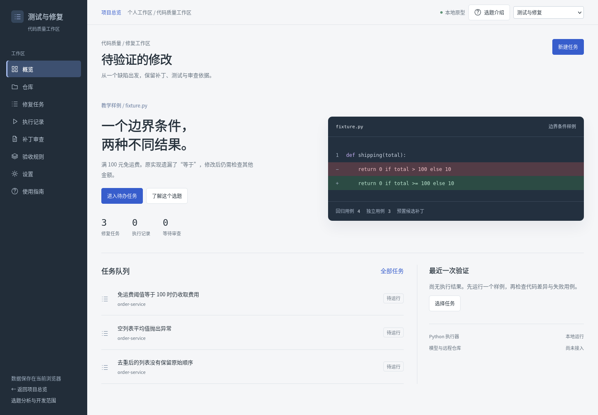
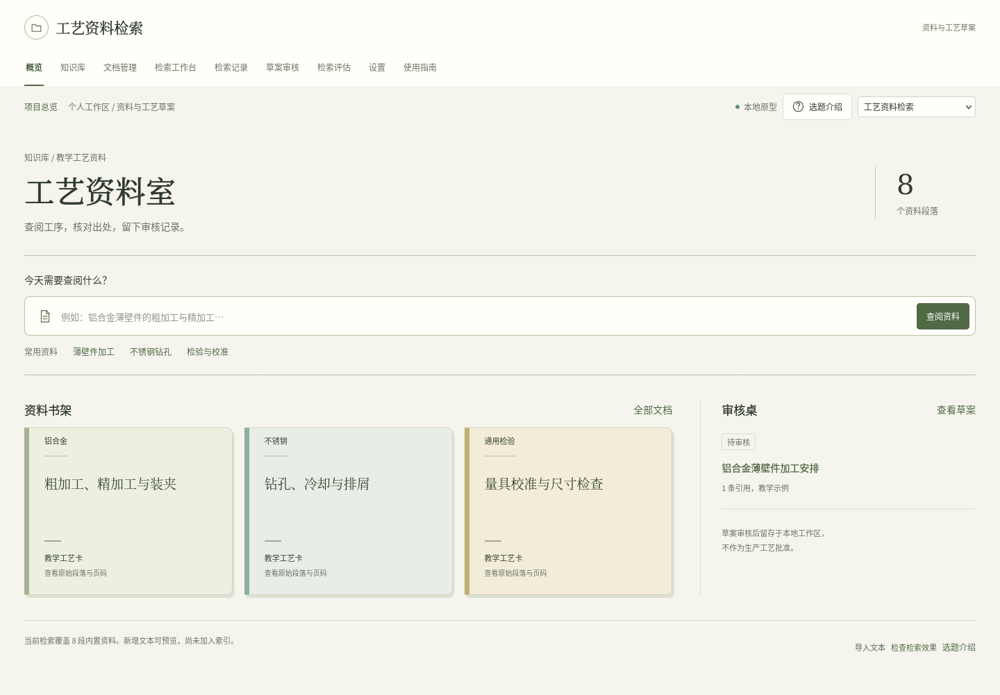
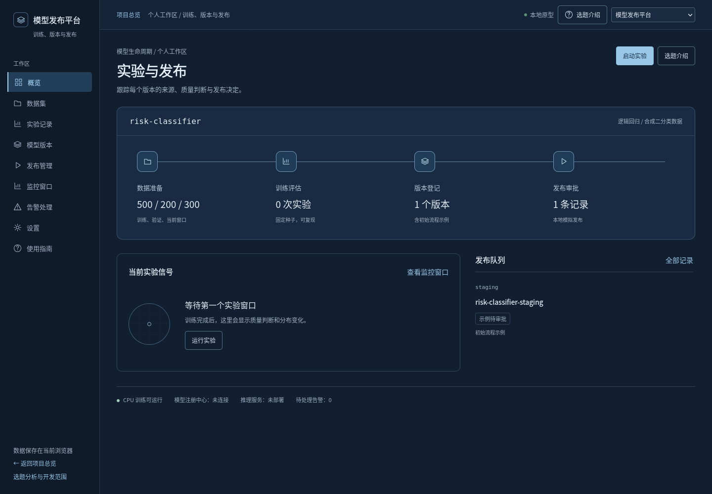
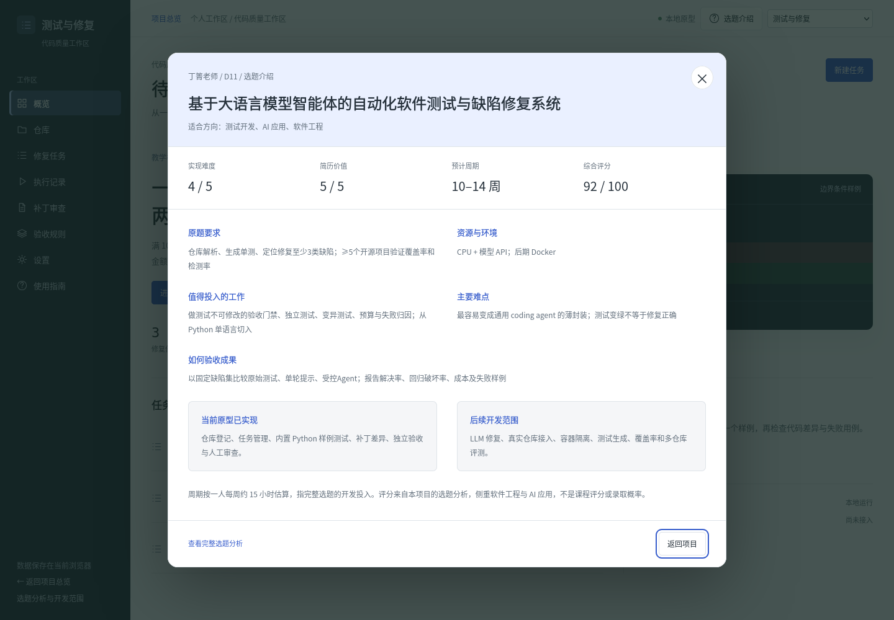
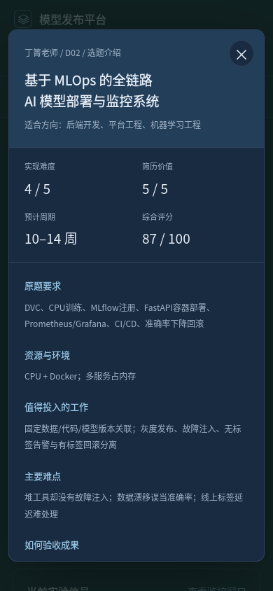

# 页面设计 skills 调研与本次应用

调研日期：2026-10-02。

## 参考来源

| Skill / 资料 | 官方来源 | 本次用途 |
|---|---|---|
| Anthropic `frontend-design` | https://github.com/anthropics/skills/blob/main/skills/frontend-design/SKILL.md | 根据项目内容确定视觉方向，分别设计首页与内容容器，减少通用卡片模板 |
| Vercel `web-design-guidelines` | https://github.com/vercel-labs/agent-skills/blob/main/skills/web-design-guidelines/SKILL.md | 检查交互元素、焦点、主题、移动布局与动效 |
| Vercel Web Interface Guidelines | https://github.com/vercel-labs/web-interface-guidelines/blob/main/command.md | 对照原生按钮、表单标签、可见焦点、深色控件与弹窗滚动要求 |

已读取公开 skill 内容作为设计与审查依据，没有将第三方 skill 安装到用户环境。插件目录也检索了 UI/UX 与前端设计能力；现有仓库可直接完成本次改动，无需连接 Figma、MagicPath 或其他外部设计服务。

## 主题设计

| 项目 | 主题与构图 | 色彩 | 字体与内容处理 |
|---|---|---|---|
| 测试与修复 | 代码审查台：深色导航、代码差异预览、任务队列和审查侧栏 | 页面 `#f5f6f8`、导航 `#222d39`、文本 `#26313b`、操作 `#375dcc`、差异绿 `#2c4b44` | 中文使用系统无衬线；代码使用等宽字体。保留行号、文件名与测试阶段的含义 |
| 工艺资料检索 | 资料阅览室：顶部导航、查阅入口、分类书架、审核桌 | 页面 `#f5f4ed`、纸面 `#fffef8`、文本 `#303b31`、操作 `#506a45`、分隔 `#dcded1` | 标题与正文摘录采用中文宋体/衬线回退；表单与导航保持无衬线，便于操作 |
| 模型发布平台 | 发布控制室：深蓝工作区、可进入的生命周期阶段、实验信号与发布队列 | 页面 `#121f31`、面板 `#192b40`、文本 `#e7eff8`、操作 `#98c7e8`、分隔 `#30445d` | 数值和版本采用等宽；质量数据只显示实际实验结果，空状态不生成虚构曲线 |

公共组件继续共用，首页构图与视觉主题独立。列表、详情、表单、运行工作台也继承对应主题。全部字体使用系统回退，不依赖网络字体或新增包。

## 选题介绍窗口

六个项目顶部均有“选题介绍”按钮，首页另有对应入口。原生 `dialog` 展示：

- 老师来源、原题编号与名称；
- 开发难度、简历价值、预计周期、综合评分；
- 适合方向、原题要求、资源条件、主要难点与建议投入；
- 验收方式、已实现部分与后续开发范围；
- 周期与评分口径，以及完整报告链接。

数据复制自 `report/topics.json` 中对应四题，保存在 `shared/product/topics.js`，不依赖额外请求。后续调整评分或题目信息时，应保持二者一致；自动检查会比对关键字段。

窗口使用 `showModal()`，提供标题关联、初始焦点、关闭按钮、返回按钮和遮罩关闭；Escape 由原生 dialog 处理。关闭时恢复页面滚动和触发按钮焦点。弹窗支持长内容内部滚动、小屏单列和减少动态效果偏好。

## 验证边界

逻辑测试覆盖弹窗打开、按钮关闭、遮罩点击、焦点返回、背景滚动恢复、四题数据一致性，以及原有页面流程。静态检查覆盖主题资源、HTML结构与JavaScript语法。

本次通过备用官方下载源安装 Firefox，并完成1440×1000桌面、390×844窄屏的真实浏览器检查。验证四主题、常用详情页、弹窗打开/关闭、Escape、Tab焦点约束、触发按钮焦点返回、页面无横向溢出，以及检索入口→工作台→真实API→历史保存的流程，无页面脚本错误。

测试容器缺少中文字形，截图测试临时加载了官方Noto中文字体以检查排版；字体未写入项目或修改Conda环境。没有做Windows浏览器或手机硬件实测，系统字体呈现可能略有差异。

## 页面截图

以下为实际浏览器截图，使用初始示例数据。

### 测试与修复

### 工艺资料检索

### 模型发布平台

### 选题介绍

## 2026-10-19 新增主题

视频观察台采用深蓝监视器与青色时间线；需求设计台采用暖灰纸面、酒红导航与批注式需求单；文献研读室采用纸白、墨蓝与衬线标题。三个项目延续公共组件，但首页构图、资料展示和工作台分别设计。塔防演示已移除，原始25题选题资料仍保留其分析。

## 2026-10-19 D01 / D09 重设计简报

本轮使用用户提供的 `distinctive-ai-design`（含真实截图评审与两轮收敛流程），并实际读取 Anthropic `frontend-design`、Vercel `web-design-guidelines` 及其最新界面检查清单。保持现有 Python/原生 JavaScript 技术栈，无新增运行依赖。

### 探索与选择

比较三类构图：以文档归档为主的资料台、直接承载搜索/输入的任务工作台、展示处理阶段的流程画布。选择任务工作台作为 D01 首页；D09 采用适于逐项比较的评审画布。归档元数据移到文档详情和设置，处理阶段留在任务页。用当前数据库中的内容与状态组织界面，不添加虚构准确率、进度或审核成果。

| 维度 | D01 工艺资料工作台 | D09 需求评审台 |
|---|---|---|
| 主要任务 | 按材料找资料、核对证据、形成并审核草案 | 导入需求、逐条编辑用例、核对验收条件并发布 |
| 主构图 | 轻量侧边导航；首页直接检索；资料分类与待审草案 | 顶部产品导航；首页直接输入；原文 / 用例目录 / 编辑器并排 |
| 核心色 | 背景 `#f3f7f5`、纸面 `#ffffff`、墨色 `#173c35`、青绿 `#087f6b`、浅绿 `#e5f4ed`、提醒 `#9b6726` | 背景 `#f5f5fa`、纸面 `#ffffff`、墨色 `#26283f`、紫蓝 `#6854ce`、浅紫 `#eeeafb`、问题 `#a86c25` |
| 字体 | 中文系统无衬线，标题 30–36px、正文 14–15px；原文更宽松行距 | 中文系统无衬线，标题 28–32px；用例字段和编号分层，正文不采用等宽字体 |
| 功能表达 | 搜索框为主入口，结果突出文档版本与引用，草案编辑旁保留证据 | 编辑步骤按操作 / 输入 / 预期并排；问题与审核状态紧邻内容 |
| 关键交互 | 首页真实检索、材料分类、来源定位、草案编辑与审核 | 首页真实导入、用例目录切换、自动草稿、冲突恢复、批量核对 |

去除重复英文眉题、满页细线、装饰性大编号、用低对比小字传递关键状态、同一套布局仅换颜色等做法。圆角用于区分可操作容器，状态色用于解释处理/审核结果。图形只采用帮助辨认动作的原生 SVG 图标和真实关系图，不增加无业务用途的图片。

### 截图与交互评审

在实际服务中检查首页、核心工作视图、状态和窄屏；按构图、信息层级、字体、色彩、间距、一致性和主任务清晰度自查，每轮最多处理三个主要问题，最多两轮。审美自查不替代浏览器功能回归。检查键盘焦点、字段标签、减少动态效果、长内容及原有审核/冲突门禁。

### 实施与来源

- `distinctive-ai-design`：用户提供的技能包；采用方向比较、明确设计约束、实现后真实截图检查、最多两轮收敛的流程。本次由实现者自查，未将审美判断包装成用户测试结果。
- [Anthropic frontend-design](https://github.com/anthropics/skills/blob/main/skills/frontend-design/SKILL.md)：采用与任务相符的视觉方向和完整细节，避免通用模板构图。
- [Vercel web-design-guidelines](https://github.com/vercel-labs/agent-skills/blob/main/skills/web-design-guidelines/SKILL.md) 与[界面检查清单](https://github.com/vercel-labs/web-interface-guidelines/blob/main/command.md)：核查标签、键盘焦点、原生按钮/链接、移动布局和减少动态效果偏好。

D01 使用新的首页搜索、材料分类和草案待办，草案页保持内容与证据并排。D09 改为顶部导航，首页直接接收需求；宽屏编辑器展示原文、用例目录与编辑字段，窄屏使用选择器和单列布局。两者共用表单和状态基础样式，各自定义布局、配色与信息密度。选题介绍、加载错误提示和重试入口均保留。

第一轮查看真实桌面、手机宽度截图后，集中调整三项：D09 辅助文字对比度、编辑字段字号、首页文件读取控件。字段正文统一提高到 14px，辅助文字使用更深的灰紫色，文件读取改为保留原生 input 的可聚焦标签控件。第二轮检查布局与长内容，不继续叠加装饰。

自动化截图与流程测试使用同一个真实服务和隔离数据目录。截图由容器工作流的 `d01-browser-evidence` 工件保存，包含两项目首页、草案/用例编辑、矩阵、指南及390px布局；测试命令和实际结果见 [验证记录](VALIDATION.md)。本次没有新增模型能力、账户体系、运行依赖或服务端数据结构。

## 2026-10-19 D11 修复工作台

沿用已读取的 distinctive-ai-design、Anthropic frontend-design 和 Vercel web-design-guidelines。比较任务看板、聊天会话、补丁审查台三个方向，选择补丁审查台：任务的主要产物是可核查的差异和测试，聊天记录不作为页面主体。

采用石墨色导航/文件栏、暖白阅读区与琥珀操作色。通过/失败使用绿/红并附文本与符号。首页提供固定快照和待审任务，任务页左侧阶段、中间统一 diff、右侧回归与独立验收；轮次、执行状态和人工结论分开显示。点击失败用例进入输入/预期/实际/日志，再返回对应文件。手机端纵向组织，代码自动换行，保留轮次和全部证据入口。

第一轮真实截图检查后，集中调整手机代码换行、测试文字可读性、快照测试协议展示，并修正路由切换后的正文焦点。第二轮核查桌面与390px长内容；不使用虚构质量指标、预填通过状态或无功能图形。重新检查运行器不会清空任务表单。选题介绍和需求/架构/代码/任务/审查/运行六章指南保留，架构图使用原生 SVG。

浏览器截图与回归保存在容器工作流 `d01-browser-evidence` 工件，沿用名称，包含 D01/D09/D11。实现者自查不等于用户研究或跨仓库修复质量验证。

## 2026-10-19 D13 文献研读室

沿用前面已实际读取的 distinctive-ai-design、Anthropic frontend-design 和 Vercel web-design-guidelines。比较聊天会话、论文归档库、证据研读台三个方向，选择证据研读台：以原文阅读、矩阵对照和章节核对组织任务。

采用墨蓝导航（#182d45）、暖灰背景（#f4f3ed）、纸白正文（#fffefa）与低饱和蓝色操作；论文文本使用系统衬线，表单和操作使用系统无衬线。首页说明来源到论述的关系，不展示虚构的生成成绩。矩阵按方法/发现/局限分类，章节保留目录与原文窗口；桌面原文与摘录入口并排，手机按阅读顺序纵向组织。

第一轮真实截图检查集中处理三个问题：补全公共按钮的 hover/focus 主题变量，修正品牌小字换行，限制网格子项最小宽度以使窄屏表格在容器内滚动。第二轮检查桌面编辑与390px矩阵、指南和长内容；操作回归独立于审美自查。表单补齐显式可访问名称，关闭弹窗时清理临时内容，原文高亮使用 Unicode 字符定位。

架构图为原生 SVG，所有数字来自工作区或明确标为限制/流程示意。截图与真实浏览器流程保存到 CI 的 d01-browser-evidence 工件，沿用名称，现包含 D01/D09/D11/D13。未把自查或虚构教学文本验收当作研究者质量盲评。

## 2026-10-20 D02 模型发布控制室

沿用此前已实际读取的 distinctive-ai-design、Anthropic frontend-design、Vercel web-design-guidelines。比较实验笔记、监控大屏和发布控制室三个方向，选择以服务版本为主的控制室：顶部深蓝导航，钢灰工作区，琥珀发布操作；不套用D13的论文/侧栏布局。

首页先显示目标、实际加载、制品就绪和真实请求入口，再显示实验与事件。模型与预测由可核对的ID/哈希连接，指标有样本量、单位和计算范围。监控采用实际训练/窗口分箱频率，漂移与效果告警分开；无标签显示不可计算。

第一轮实际桌面截图检查后，调整预测响应为结果表与可展开JSON、即时刷新请求记录、服务校验时保留输入并更新版本信息；同时修正命名表单控件遮蔽原生属性导致的版本提交问题。第二轮检查桌面控制室、分布图及390px主页/监控/长指南；表格与图在容器内横向滚动，不撑破页面。未将实现者自查包装为用户调研或生产性能验证。

图形为原生SVG图标、架构图和实际分箱图，不新增图片依赖。选题说明弹窗、六章指南、键盘焦点和脚本/API失败恢复保留。截图由实际浏览器与隔离数据目录生成，CI沿用 d01-browser-evidence 工件名，包含五个工作区。
