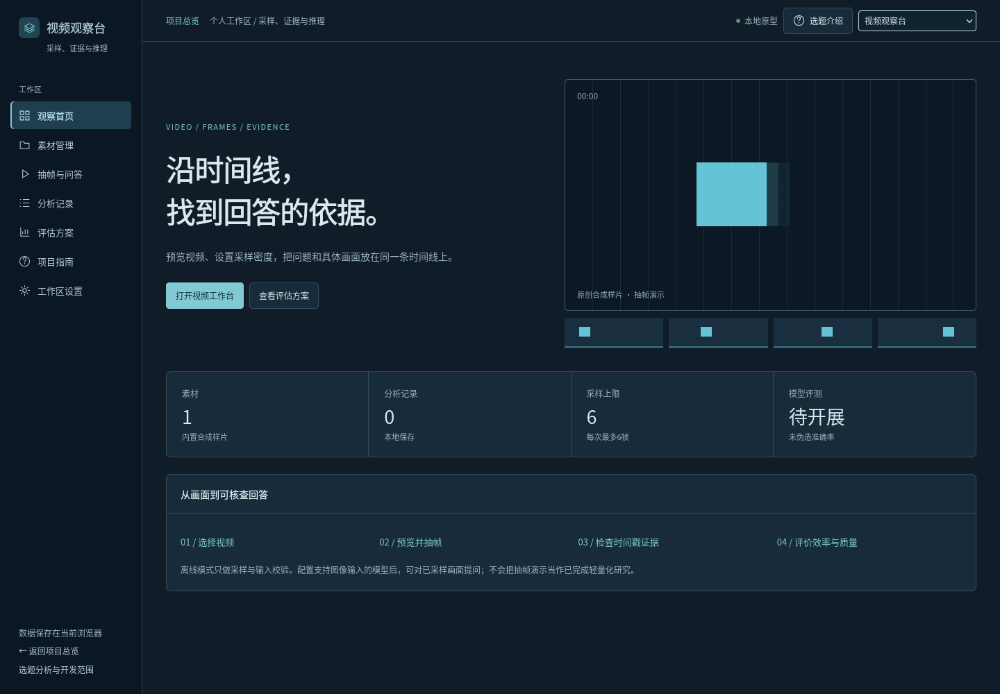
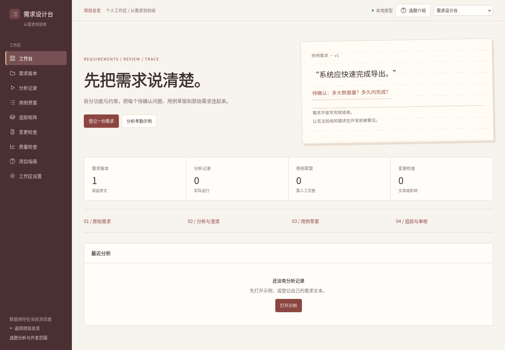
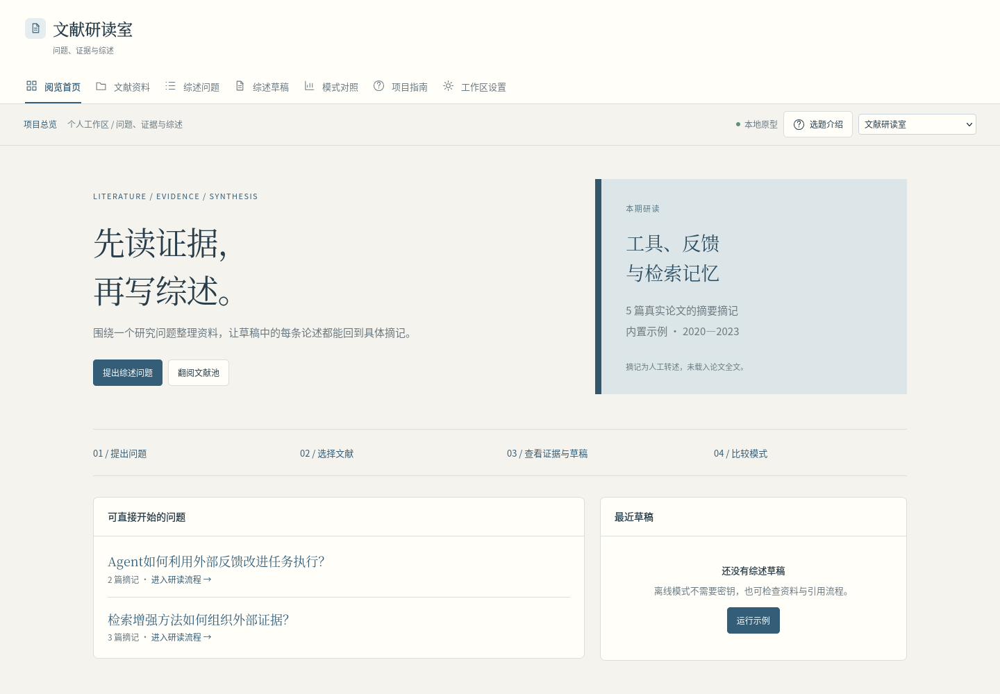

# 新增选题项目

2026-10-19更新：保留测试与修复、工艺资料检索、模型发布平台；新增以下三个项目，移除塔防演示。原始25题报告继续保留原始选题分析。

| 原题 | 目录 | 当前实际可演示的内容 | 完整选题待完成 |
|---|---|---|---|
| 项目九：大模型API需求分析与用例生成 | demos/05-requirements | 版本、原文提取、待确认问题、模板用例、人工核对、追踪、文本变更 | ER/UML、语义一致性、100样例独立评测 |
| 项目十二：轻量多模态视频理解与推理 | demos/04-video-understanding | 真实预览与抽帧、时间线、离线校验、可选视觉模型问答、证据记录 | 本地模型轻量化、至少两基准、效率精度对照 |
| 项目十三：多智能体文献综述 | demos/06-literature | 摘记池、固定问题、离线/单次/并行模型模式、引用定位、逐条人工审核 | 全文检索、框架化长任务恢复、2–3子领域盲评 |

全部继续使用根目录一键启动与共用环境。离线模式无需密钥，模型配置见 [MODEL_SETUP.md](MODEL_SETUP.md)。模型失败不会伪装为离线成功；模型质量尚未用真实服务验收。

## 视频观察台

内置样片由本项目使用FFmpeg生成，无第三方视频。用户本地视频仅在当前浏览器会话解码；保存分析时只保留缩略图、问题、回答和时间戳。离线模式没有视觉语义推理。

## 需求设计台

模型模式只提取角色与标题，用例仍由本地模板构建并标记待完善。版本关联必须与运行时原文一致，改变工作台原文会转为自由文本分析。人工核对不等于自动测试执行。

## 文献研读室

资料池的标题和来源对应真实论文，note字段为依据摘要的人工转述。自动quote检查只针对这些摘记的位置，不代表原文语义支持。新登记文献暂不参与服务端分析。

内置资料原文：

- [RAG, Lewis et al.](https://arxiv.org/abs/2005.11401)
- [ReAct, Yao et al.](https://arxiv.org/abs/2210.03629)
- [Reflexion, Shinn et al.](https://arxiv.org/abs/2303.11366)
- [Self-RAG, Asai et al.](https://arxiv.org/abs/2310.11511)
- [Lost in the Middle, Liu et al.](https://arxiv.org/abs/2307.03172)

截图使用初始数据；浏览器和实际模型验证边界见 [VALIDATION.md](VALIDATION.md)。
