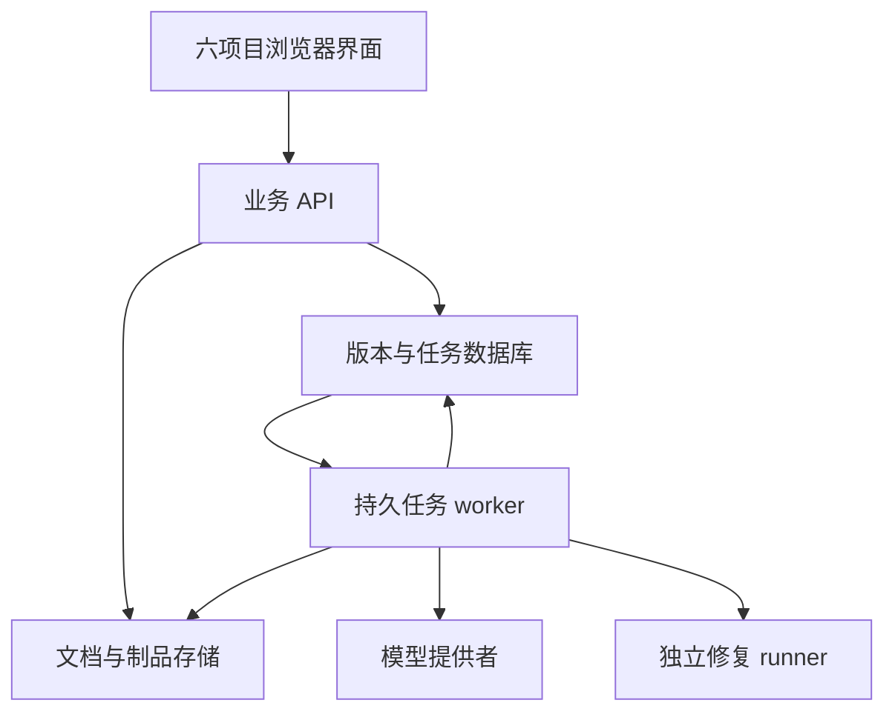

# 六个工程实践项目：参考调研与完善计划

调研日期：2026-10-19。代码基线：`4956ee6d0852a6371549efada6804dbd7a2eb6e1`。状态：原始规划与调研基线；D01、D09、D11 和 D13 已交付本机工作区首版，当前功能与限制见 [D01说明](D01_WORKSPACE.md) 、[D09说明](D09_WORKSPACE.md)、[D11说明](D11_WORKSPACE.md) 和 [D13说明](D13_WORKSPACE.md)。独立业务质量评估尚未完成。其余能力不因本报告而视为已实现。

## 1. 结论与交付定位

六个选题在开源社区和商业市场中均有可参考对象，但产品、组件与研究模型的完整度不同。共选取 18 个主要参考对象，每项三例；另列技术、模型卡与基准来源。建议保留现有六套主题和入口，以共用后端能力支撑六条独立业务流程，逐项交付小规模可用版本。

当前主要差距是持久化、真实输入处理、后台任务、版本追溯、错误恢复和结果核查。页面完善应与这些能力绑定，优先建设能帮助用户完成任务的编辑器、比较视图、证据面板和状态反馈。默认 CPU 部署继续一条命令启动，GPU 与外部服务按需接入。

这里的“可用”指：在受控数据规模、明确支持格式与权限范围内，能够导入真实输入、完成核心处理、保存与修订结果、处理失败并导出可核查产物。不以全面复刻成熟商业平台或具备生产 SLA 为首版目标。

## 2. 调研方法与证据边界

- 已核对本仓库 `server.py`、`shared/model_client.py`、`shared/product/core.js`、Compose、项目引擎与现有说明，确认真实计算与浏览器模拟的分界。
- 参考对象依据官方仓库 README、公开产品文档、界面示例与接口说明；对 mini-SWE-agent 另查看了默认代理的预算限制代码。没有完整审计全部源码，也没有购买或登录商业服务实测。
- “公开能力”是来源明确支持的描述；“建议借鉴”“不照搬”和后续架构、指标、工时均为本项目的分析与规划。商业宣传的准确率、节时和榜单成绩不作为本项目结果。
- 资料可公开访问不等于所有代码、模型权重、数据与服务均适用相同许可；本次不直接引入第三方源码。组件落地前固定版本并记录许可和数据来源。
- 维护变化：SWE-agent 官方建议新使用者考虑 mini-SWE-agent；OpenHands 当前界面主仓库与代理 SDK 分工变化；Qwen 旧仓库入口已转向 Qwen3-VL。相关来源见 A01、T05、V01。

## 3. 当前系统与共用改造

| 层面 | 当前实现 | 可用版本要求 |
|---|---|---|
| 数据 | 浏览器 LocalStorage，计算返回值临时保存；无共享业务库 | 服务端版本化对象与文件持久化；浏览器只作缓存和草稿；迁移、备份与恢复 |
| 服务 | 单文件标准库 HTTP 服务，六个引擎启动时加载 | FastAPI 分模块 API，schema 校验、统一错误、稳定对象 ID；静态文件使用显式白名单 |
| 任务 | 同步请求；模型调用最多等待 45 秒；无持久任务队列 | 持久任务、取消、节点产物、重试边界、重启恢复与运行事件 |
| 模型 | 三个项目可选同一组服务端模型变量；无实际用量统计 | 提供者能力与配置版本、输出校验、按运行记录实际用量与未知项、预算控制 |
| 权限 | 本机回环访问与同源检查；无多用户身份 | 本机默认模式；启用共享访问前落实登录、工作区对象权限、审核身份与审计 |
| 页面 | 六套主题、多页面、iframe 工作台、LocalStorage 状态 | 共享 API/store 适配器；每次操作可见保存状态，结果有来源、版本和失败恢复 |
| 部署 | 六项目同一容器，非 root、只读根文件系统、健康检查 | 同一业务镜像的 app 与 worker，具备 /data 命名卷；可选模型与 runner 适配 |

### 3.1 技术选型与渐进迁移

业务服务建议采用 Python 3.12、FastAPI/Pydantic、SQLAlchemy/Alembic，单机试用默认 SQLite WAL。保留引擎函数，通过服务层调用；旧 `/api/*` 暂用适配路由，待浏览器流程迁移后再退役。涉及依赖安装时同步更新共用 Conda 环境、容器锁定依赖和无 Conda 清单。

前端首版继续使用原生 ES modules 与现有主题，提取 `api-client`、`repository/store`、`job-view`、`review-panel` 等共用模块。先替换存储和请求边界，再逐页迁移工作台；不同时重写六个项目。只有当编辑器、虚拟表格和组件维护成本经记录证明过高时，再单独评估 Vue/React 与构建工具。

默认无需 Redis、Kubernetes 或微服务。worker 与 app 使用同一个业务镜像及依赖，数据库任务表承担小规模队列；一个 worker 起步，短事务、租约与幂等产物写入。若实测写锁争用、排队时长或多机协作需要扩大，再迁移 PostgreSQL 与专门队列，不能仅更换数据库连接串而省略迁移验证。

GPU 推理服务和缺陷执行 runner 为外部能力适配器，不为六个业务项目各建环境。runner 不获得 Web 服务的 Docker socket、数据库、密钥或宿主目录；不可信任务通过独立执行边界管理。GPU 模型与业务 Python 依赖冲突时，保持模型服务独立。

参考技术资料：T01、T02、T03。以上是待实施架构，不代表当前服务已使用这些组件。

### 3.2 数据与任务的关键约定

- 共用对象包含 `Workspace`、`User`、`Membership`、`Asset`、`AssetVersion`、`Job`、`JobEvent`、`Artifact`、`Review`、`AuditEvent`。各项目独立定义领域表，不能把六种任务都塞进无约束大 JSON。
- `Job` 保存状态、阶段、输入版本、配置哈希、取消请求、worker 租约和最后心跳。状态为 queued/running/cancelling/succeeded/failed/cancelled/interrupted，终态与重试派生运行分别保存。
- 模型与文件操作不放在数据库长事务中。产生外部调用前检查预算，成功结果写入节点产物后再进入下游；发生“请求已发出但响应未落库”的不确定状态时暂停并提示确认，不能承诺 exactly-once 或自动重复计费。
- 版本为追加写入；草稿更新带版本号，过期写入返回 409。审核结论绑定具体版本，内容改变后原审批不自动沿用。删除源文件要使证据、索引和派生产物同步失效。
- `/data` 位于静态服务目录之外，初始化为 UID 10001 可写；根文件系统继续只读。备份同时包含数据库快照、文件清单、哈希和 schema 版本，恢复需通过校验。
- 本地默认模式与多人共享模式的状态在界面可见。多人共享需先通过权限验证，不能简单把端口从 127.0.0.1 改为公网地址。

## 4. 六个项目的参考与改进

### D09 · 需求设计台

**可用版本定位**：面向需求评审与测试设计的工作台；以一个可修订、可追踪、可导出的用例集为交付物。

**调研基线差距**：原模型只提取角色和标题，用例来自模板，记录留在浏览器。**首版更新**：已实现服务端版本、真实模型用例生成、自动草稿/冲突、追踪审核与发布回导；当前范围见 [D09说明](D09_WORKSPACE.md)。下列依赖和工时仍为原始方案，独立质量数据尚未完成。

| 参考对象与类型 | 公开能力 | 建议借鉴 | 差异与取舍 |
|---|---|---|---|
| [ZenTao 禅道](https://github.com/easysoft/zentaopms) · 开源版 / 商业版本 [Q01] | 公开仓库覆盖产品、项目与质量管理，并区分开源及商业版本。 | 围绕需求、测试用例和缺陷建立稳定对象编号与关联。 | 是需求与测试生命周期参照，不据此认定开源版具备商业版全部 AI 能力。 |
| [Kiwi TCMS](https://kiwitcms.readthedocs.io/en/latest/guide/testcase.html) · 开源测试管理 [Q02] | 文档展示测试用例创建、内容维护及版本历史。 | 设计用例的步骤、预期结果、审核和版本变化；借鉴测试管理对象关系。 | 偏测试管理，不是自然语言需求理解引擎；不将其列为同类 AI 生成算法。 |
| [Qase AI Test Designer](https://docs.qase.io/en/articles/9653096-ai-test-designer) · 商业 SaaS [Q03] | 支持由需求生成待审核用例，选择保留后保存，并标记 AI 来源。 | 采用输入依据、逐项修改、批量审核、确认入库的流程。 | 其文档提示未保存结果可能丢失；本项目应增加自动草稿，不能机械照搬。 |

**核心流程**：导入需求并固定版本 → 提取验收条件和歧义 → 生成结构化用例 → 修改与审核 → 发布用例集并导出。

**功能改造**：

1. 支持 Markdown/TXT 导入，段落标识与原文偏移随版本固定；无效格式和缺失信息明确提示。
2. 需求项含角色、行为、前置条件、约束与验收标准；模型输出使用 schema 校验，缺少依据时形成待确认问题。
3. 生成正向、异常、边界及权限场景的步骤、输入和预期；可逐条改写、增删、去重并关联验收条件。
4. 需求修订触发受影响用例标记，保留旧版本；AI 建议经人工接受后建立新版本。
5. 导出 CSV/JSON/Markdown，附需求版本、审核者、时间与来源；ER/UML 在后续独立验收。

**页面与交互改造**：

- 蓝灰与纸白主题，以需求原文、用例编辑器、追踪矩阵三种工作模式组织。
- 桌面原文与用例并排，点击来源定位段落；窄屏切为有当前位置提示的顺序页。
- 用例行展示人工/模型来源、待确认/已核对状态；批量操作前显示影响数量。
- 修改自动保存草稿，保存冲突显示差异；生成中显示当前阶段与取消入口，不锁死全文编辑。

**数据对象**：`RequirementDocument`、`RequirementVersion`、`RequirementItem`、`AcceptanceCriterion`、`TestCaseVersion`、`TraceLink`、`Review`。

**建议 API 契约（待实现）**：

- `POST /api/v1/requirements/import`
- `POST /api/v1/requirements/{id}/analyses`
- `POST /api/v1/testcase-sets/{id}/reviews`
- `GET /api/v1/testcase-sets/{id}/export`

**验收与质量评估**：

- 功能门槛：跨浏览器查看同一版本；刷新不丢草稿；旧版本不可被覆盖；冲突写入返回 409；导出可重新导入核对。
- 质量方案：100 条需求按来源/业务场景分组划分 20 条开发、80 条保留测试；两名审核者标注验收条件与场景，报告提取 P/R/F1、用例可用率、重复率及核对耗时。
- 候选质量目标：验收条件召回率 ≥85%、人工可用率 ≥80%；先测规则和单轮提示基线再冻结门槛，未达标保留人工编辑流程。

**首版范围控制**：首版不做任意系统自动执行、复杂 UML 建模或全量 Jira 同步；文本变更与语义建议分别标识。

**执行顺序**：第 1 项；预计新增开发工作 38–58 小时，不含共用层与缓冲。

资料：[Q01](#q01)、[Q02](#q02)、[Q03](#q03)。

### D01 · 工艺资料检索

**可用版本定位**：面向工艺资料维护和工艺草案审核，建立从真实文档到有来源草案的完整流程。

**当前差距**：当前只有八段教学语料进入索引；上传文本只供预览，草案未调用模型。

| 参考对象与类型 | 公开能力 | 建议借鉴 | 差异与取舍 |
|---|---|---|---|
| [RAGFlow](https://github.com/infiniflow/ragflow) · 开源项目 [R01] | 公开提供文档解析、分块干预和可追溯引用。 | 学习导入状态、分块预览、来源回跳；将工艺草案与证据绑定。 | 参考其流程，首版不引入整套基础设施；不能把其性能声明视为本项目指标。 |
| [Dify](https://github.com/langgenius/dify) · 公开源码，附加许可条件 [R02] | 将知识摄取、检索、模型配置与工作流组织在同一平台。 | 借鉴索引配置与检索调试的分工，以及明确的失败反馈。 | Dify 使用附加条件许可；学习交互和边界，不直接复制界面或默认纳入其整个平台。 |
| [Glean Search](https://www.glean.com/enterprise-search) · 商业服务 [R03] | 官方说明企业检索遵循数据源权限，并呈现结果与内容来源。 | 检索前按工作区限制候选文档；结果旁显示来源、版本与更新时间。 | 企业通用搜索是相邻产品，不直接解决工艺结构、单位和审批约束；未进行付费产品实测。 |

**核心流程**：上传与解析文档 → 确认分块并建索引 → 检索与核对证据 → 生成结构化草案 → 审核与导出版本。

**功能改造**：

1. 先支持 TXT/Markdown 和可提取文本的 PDF；文档哈希去重、版本替换、删除同步索引；扫描 PDF 明确提示暂不支持。
2. 每个分块保存文档版本、页码、段落偏移和材料/设备标签；BM25 作为基线，嵌入与融合为可切换策略。
3. 生成的工艺步骤包含材料、设备、操作、参数/单位、依据和待确认项；无依据的数值不得补造。
4. 提供索引任务进度、失败重试与检索调试；重建时继续使用上一可用索引，完成后原子切换。
5. 将审核通过的草案固定为版本并导出 Markdown/JSON；源文档更新后标记受影响草案。

**页面与交互改造**：

- 暖白与深绿的资料阅览室主题，避免通用聊天页占据全部空间。
- 主视图为文档目录、页内证据、草案三栏；检索结果显示版本与定位信息。
- 分块边界可预览，错误解析可标记退回；导入页逐文件显示解析/索引状态。
- 工艺参数使用字段与单位编辑；缺证据处显示待确认，审核抽屉聚焦具体字段与来源。

**数据对象**：`Document`、`DocumentVersion`、`Chunk`、`IndexVersion`、`RetrievalRun`、`ProcessDraftVersion`、`EvidenceLink`。

**建议 API 契约（待实现）**：

- `POST /api/v1/knowledge/documents`
- `POST /api/v1/knowledge/index-jobs`
- `POST /api/v1/process-drafts`
- `POST /api/v1/process-drafts/{id}/reviews`

**验收与质量评估**：

- 功能门槛：新上传内容可检索；删除后不再命中；源文档与引用可定位；失败索引不覆盖可用版本；全部批准参数具备证据或人工确认标记。
- 质量方案：至少 20 份授权或自编文档、100 个问题，按文档族划分开发/保留集，含至少 20 个不可回答问题；同一语料比较 BM25、嵌入和融合。
- 报告 Recall@5、MRR、引用支持率与拒答 P/R；候选目标 Recall@5 ≥85%、引用支持率 ≥90%，报告样本量、区间及人工复核分歧。

**首版范围控制**：先完成文本 PDF；OCR、复杂表格和多租户企业连接器另列迭代，不以通用聊天准确率替代工艺可靠性。

**执行顺序**：第 2 项；预计新增开发工作 46–70 小时，不含共用层与缓冲。

资料：[R01](#r01)、[R02](#r02)、[R03](#r03)。

### D11 · 测试与修复

**可用版本定位**：面向受控 Python 仓库的缺陷修复工作台，交付可审查补丁、独立测试与完整执行证据。

**实施更新（2026-10-19）**：已交付固定教学快照、SQLite 任务/事件/候选/审查、独立 Docker worker 和一次性受限测试容器，支持离线、手写与可选模型候选及最多两次修订。页面提供 diff、逐项测试与日志联动。Conda/venv 本地模式仍只执行内置可信候选。

**当前差距**：尚未接入外部授权 Git 仓库与依赖镜像、多人认证或5仓库/30缺陷的跨仓库质量评测。完整范围与接口见 [D11工作区](D11_WORKSPACE.md)。

| 参考对象与类型 | 公开能力 | 建议借鉴 | 差异与取舍 |
|---|---|---|---|
| [OpenHands Agent Canvas / SDK](https://github.com/OpenHands/OpenHands) · 开源界面 / 代理生态 [A01] | 当前仓库定位为编码代理控制中心，支持不同执行后端。 | 学习会话、任务与执行后端分离，提供可审阅的运行过程。 | 界面仓库与代理 SDK 分工已变化；不将当前主仓库当作单一旧版代理内核。 |
| [mini-SWE-agent](https://github.com/SWE-agent/mini-swe-agent) · 开源代理 [A02] | 以简洁代理、模型及环境接口支持软件任务和不同执行环境。 | 借鉴受控循环、环境适配器、轨迹记录与预算上限。 | 只学习结构，不把其公开基准成绩作为本项目结果，也不直接开放无限 shell。 |
| [Devin](https://docs.devin.ai/get-started/devin-intro) · 商业服务 [A03] | 官方产品说明涵盖写代码、运行测试、处理缺陷与工程集成。 | 把用户目标、执行过程、补丁产物和审查入口组织为一个任务。 | 商业能力按官方公开文档理解；未验证自动修复成功率或隐藏执行机制。 |

**核心流程**：选择受控仓库与基线提交 → 复现缺陷并固定测试 → 模型提出候选补丁 → 隔离验证与有限修订 → 人工审核并导出补丁。

**功能改造**：

1. 仅开放白名单仓库与固定提交；依赖在预构建镜像中准备，记录基线 SHA、测试集哈希、环境 digest。
2. 任务执行器独立部署并运行一次性受限环境，默认禁网、无宿主凭据、无宿主目录/应用数据库挂载，限制 CPU、内存、进程数和时长。
3. 代理循环限定读取、受控编辑和测试动作；最多两次修订，保存模型输入版本、工具轨迹与每轮补丁。
4. 应用前验证 diff 路径、文件类型与大小，测试目录与验收脚本只读；回归或独立验收失败的补丁不能转为通过。
5. 支持运行中取消、失败原因归类、补丁下载和人工审查；创建远程 PR 放到后续显式操作。

**页面与交互改造**：

- 石墨色代码审查台；亮色阅读区保障长 diff 可读性。
- 左侧任务与步骤，中部统一 diff，右侧测试结果；选中失败测试联动日志和修改文件。
- 区分任务状态、测试状态和人工审查结论；显示原提交与候选 SHA，避免单一绿色通过标记。
- 取消、超时、预算耗尽与运行器不可用各有恢复操作；审核按钮仅在门禁满足时可用。

**数据对象**：`RepositorySnapshot`、`RepairTask`、`Attempt`、`PatchArtifact`、`TestSuiteSnapshot`、`TestRun`、`RunnerLease`、`Review`。

**建议 API 契约（待实现）**：

- `POST /api/v1/repair/tasks`
- `GET /api/v1/repair/tasks/{id}/events`
- `POST /api/v1/repair/tasks/{id}/cancel`
- `GET /api/v1/repair/attempts/{id}/patch`

**验收与质量评估**：

- 功能门槛：越界路径、修改验收测试、超预算、超时及失败补丁均有确定处理；取消后回收环境；重启后任务可判定为中断或继续，不重复发布产物。
- 质量方案：至少 5 个授权开源 Python 仓库、30 个独立缺陷，覆盖至少 3 类；开发与测试按仓库/缺陷族隔离；保留只用于验收的测试。
- 比较无修复、同模型单轮与受控循环，固定模型/预算/测试协议；报告解决率、回归破坏率、测试篡改拦截、耗时和成本，不预设高成功率。

**首版范围控制**：首版不支持任意公网仓库或多语言。独立 runner 未就绪时保留可信样例模式，不把应用容器等同任务沙箱。

**执行顺序**：第 3 项；预计新增开发工作 60–98 小时，不含共用层与缓冲。

资料：[A01](#a01)、[A02](#a02)、[A03](#a03)、[T04](#t04)、[T05](#t05)。

### D13 · 文献研读室

**可用版本定位**：面向小规模专题综述，以论文证据矩阵和人工审核为中心，生成可追溯的章节草稿。

**当前差距**：当前处理五篇论文的人工摘要转述；新登记论文不参与分析，自动检查只匹配摘记位置。

| 参考对象与类型 | 公开能力 | 建议借鉴 | 差异与取舍 |
|---|---|---|---|
| [STORM / Co-STORM](https://github.com/stanford-oval/storm) · 开源研究系统 [L01] | 将研究、提纲、正文与润色分为模块，并支持引用。 | 先建立研究问题和提纲，再围绕证据逐节写作与核查。 | 通用知识报告与科研系统综述并不等价；必须另加论文筛选、数据提取和人工审核。 |
| [Open Deep Research](https://github.com/langchain-ai/open_deep_research) · 开源研究代理 [L02] | 通过 LangGraph 组织研究流程，区分研究、压缩与报告模型配置。 | 学习任务阶段、角色配置及中间产物，允许只重跑失败节点。 | 首版不直接移植完整搜索代理；摘要压缩结果必须仍可定位原始证据。 |
| [Elicit Systematic Review](https://elicit.com/solutions/systematic-review) · 商业服务 [L03] | 官方展示筛选、提取、句级来源和可查看中间过程。 | 以证据矩阵为工作中心，保存纳入排除理由，编辑正文时联动来源。 | 仅参考公开功能与界面示例；不沿用厂商节时或准确率宣传值。 |

**核心流程**：定义问题与纳入标准 → 导入论文并去重 → 提取证据矩阵 → 确认提纲并分节写作 → 核查引用与导出。

**功能改造**：

1. 支持 DOI/元数据登记与合法 PDF 导入；DOI、标题和哈希联合去重，区分仅摘要与全文可用。
2. 提取研究问题、方法、数据、指标、局限与结论，证据绑定论文版本、页码与字符偏移。
3. 记录纳入/排除理由；提纲先经确认，再由阅读、综合、核查角色处理相同证据集。
4. 流程节点有输入哈希与中间产物，失败时只重跑对应节点；更换论文或提纲后使下游结果过期。
5. 导出 Markdown 和 BibTeX，检查正文引用标识与文献表一致；“无支持”“有冲突”作为可见结果。

**页面与交互改造**：

- 米白与墨红的学术阅读主题，以证据表格和正文排版为主体。
- 论文库 → 证据矩阵 → 提纲 → 章节编辑四个工作区；PDF 与引用抽屉联动。
- 矩阵单元格展示摘要/全文来源及人工核对状态；冲突结论并列，不自动合并成一致意见。
- 章节审核显示尚未定位、未复核或过期引用；支持从断点继续，成本预览按节点呈现。

**数据对象**：`Paper`、`PaperVersion`、`ReviewProtocol`、`ScreeningDecision`、`EvidenceCell`、`OutlineVersion`、`SectionDraft`、`CitationLink`、`WorkflowNode`。

**建议 API 契约（待实现）**：

- `POST /api/v1/literature/papers`
- `POST /api/v1/literature/protocols`
- `POST /api/v1/literature/workflows`
- `GET /api/v1/literature/reviews/{id}/export`

**验收与质量评估**：

- 功能门槛：摘要与全文清晰区分；每条导出引用可回到实际论文或明确标为待核查；删除/更新论文使相关正文过期；任务中断可恢复。
- 质量方案：2–3 个子领域、每领域 10 篇授权全文，建立至少 60 条人工证据；两名审核者盲评单次模型和多角色流程，保持证据、模型与预算可比。
- 报告引用位置有效率、语义支持率、主题覆盖、无依据结论率和审核耗时；候选目标引用位置有效率 100%、语义支持率 ≥90%，并报告人工分歧。

**首版范围控制**：首版不抓取付费墙、自动宣称系统综述合规或自动投稿；先完成小规模领域，全文复杂表格后置。

**执行顺序**：第 4 项；预计新增开发工作 48–76 小时，不含共用层与缓冲。

资料：[L01](#l01)、[L02](#l02)、[L03](#l03)、[T08](#t08)。

### D02 · 模型发布平台

**可用版本定位**：面向传统表格模型的小型训练—注册—部署—监控平台，首版只支持受信训练流水线。

**当前差距**：当前模型和数据均为合成实验，未保存权重；发布、流量和告警操作留在浏览器。

| 参考对象与类型 | 公开能力 | 建议借鉴 | 差异与取舍 |
|---|---|---|---|
| [MLflow Model Registry](https://mlflow.org/docs/latest/ml/model-registry/) · 开源组件 / 托管版本 [M01] | 支持模型版本、血缘、别名、标签及 UI/API。 | 将实验、模型制品和实际服务版本关联；区分注册别名与服务生效状态。 | 别名更新不等于所有服务实例已热加载；本项目必须单独实现加载确认与回滚验证。 |
| [Evidently](https://docs.evidentlyai.com/introduction) · 开源框架 / 平台 [M02] | 提供数据质量、漂移与 AI 评估，以及可视化报告。 | 把参考窗口、当前窗口、样本量、标签可用性与指标解释放在同一页面。 | 漂移不是效果下降的充分证据；首版复用评估库，不再建设第二套监控平台。 |
| [Amazon SageMaker Model Registry](https://docs.aws.amazon.com/sagemaker/latest/dg/model-registry.html) · 商业托管服务 [M03] | 官方文档展示模型版本、元数据、血缘与生命周期管理。 | 学习部署前审批、制品版本与运行环境的对应关系。 | 作为流程参照；首版使用本地容器服务，不引入 AWS 账号或云资源依赖。 |

**核心流程**：版本化数据并训练 → 记录实验与制品 → 审核并部署版本 → 真实请求与窗口监控 → 回滚与验证。

**功能改造**：

1. 接入授权表格 CSV 数据，固定训练/验证/监控窗口划分，记录 schema、数据哈希与实验参数。
2. 使用 MLflow 本地追踪与注册适配器；保存训练产生的受信模型制品、指标与血缘，不开放任意 pickle 上传。
3. 建立真实 /predict 服务；审批后加载候选版本，健康验证通过才改变活动指针，失败保留原模型。
4. 采集请求窗口、数据质量和漂移，标签到达后才计算效果；无标签明确显示不可计算。
5. 回滚恢复历史制品并进行实际预测校验，保留审批、部署、监控和回滚事件。

**页面与交互改造**：

- 深蓝控制室主题，关键版本与生效时间优先于大屏装饰。
- 实验比较表展示同一数据切分的结果；部署详情分开显示目标版本、加载版本与健康状态。
- 监控图同时标注窗口、样本量、阈值和标签状态；漂移提示与质量下降使用不同状态。
- 回滚前展示影响范围，操作后展示真实预测返回的版本；事件时间线支持追查失败。

**数据对象**：`DatasetVersion`、`ExperimentRun`、`ModelVersion`、`Deployment`、`ActiveModelPointer`、`PredictionEvent`、`MonitoringWindow`、`Alert`。

**建议 API 契约（待实现）**：

- `POST /api/v1/mlops/training-jobs`
- `POST /api/v1/mlops/deployments`
- `POST /api/v1/mlops/predict`
- `POST /api/v1/mlops/deployments/{id}/rollback`

**验收与质量评估**：

- 功能门槛：容器重启可恢复活动模型；100 次测试请求返回正确的服务版本；加载失败不切换；回滚后预测确由历史模型产生。
- 质量方案：干净、特征偏移、标签偏移和标签缺失四组可复现窗口；比较教学 PSI 与 Evidently 报告，不把漂移自动判为效果下降。
- 报告部署成功率、加载/回滚时长、监控延迟与告警误报；性能基线标注硬件、并发、窗口及模型，不预先承诺吞吐。

**首版范围控制**：首版使用单实例串行版本切换；真实百分比灰度、Kubernetes、多云调度与自动重训练另行实现。

**执行顺序**：第 5 项；预计新增开发工作 48–76 小时，不含共用层与缓冲。

资料：[M01](#m01)、[M02](#m02)、[M03](#m03)。

### D12 · 视频观察台

**可用版本定位**：面向短视频的可检索、可定位问答工作台；产品可用性与本地轻量模型研究分为两个验收层次。

**当前差距**：当前浏览器抽帧真实可用，离线仅校验 JPEG 与时刻；视频原件未持久化，未进行本地模型评测。

| 参考对象与类型 | 公开能力 | 建议借鉴 | 差异与取舍 |
|---|---|---|---|
| [Qwen3-VL](https://github.com/QwenLM/Qwen3-VL) · 开放模型与代码 [V01] | 官方介绍视频理解和时间戳对齐，提供多个规模模型。 | 以小规模模型构建本地推理适配器，保存抽帧与模型配置。 | 原 Qwen2.5-VL 仓库入口已重定向；建议固定模型与依赖版本后验证，不照抄历史安装命令。 |
| [VideoLLaMA3](https://github.com/DAMO-NLP-SG/VideoLLaMA3) · 研究模型与代码 [V02] | 公开提供 2B/7B 模型和视频推理示例。 | 参考视频处理与评估组织，作为第二模型或方法对照。 | README 同时注明研究预览的非商业服务限制；不据 Apache 标签认定全部模型与数据可商用。 |
| [TwelveLabs Search](https://docs.twelvelabs.io/docs/guides/search) · 商业 API [V03] | 检索返回视频标识、片段起止时间及排序信息。 | 结果绑定时间区间，点击证据回到相应片段；建立视频任务而非临时聊天。 | 可用于交互参照，首版不依赖该付费 API；检索相关性不能替代事件推理正确性。 |

**核心流程**：导入并保存素材 → 采样与生成处理任务 → 执行模型分析 → 定位与核查证据 → 导出记录与比较实验。

**功能改造**：

1. 限制首版素材时长 10 分钟、文件 200 MB，校验容器格式；服务端保存原件、哈希、缩略图与元数据，删除同步清理。
2. 使用 FFmpeg 固定解码时间基准；先均匀采样，再对比镜头/变化采样，保存实际解码时间戳和帧映射。
3. 模型提供者分为远端视觉 API 和本地推理服务；能力探测显示是否支持视频/图像、最大帧数与超时。
4. 回答返回证据时间区间与不确定性；播放器点击证据跳转，原片缺失或模型不可用时明确标识。
5. GPU profile 先验证 Qwen3-VL-4B 可运行，再做量化/采样消融；通用 CPU 入口仍可整理素材和调用已配置的外部服务。

**页面与交互改造**：

- 暗青与琥珀的视频工作台主题，播放器与时间线为主要视觉区域。
- 上方播放器、下方可缩放时间线与采样帧；右侧问题、回答和证据。
- 原始视频时刻、实际采样时刻和模型证据区间分别展示；切换采样方案使旧分析标为过期。
- 上传、转码、采样、推理各有状态；不支持的编码、模型离线和额度不足提供具体处理入口。

**数据对象**：`VideoAsset`、`MediaVersion`、`SamplingPlan`、`FrameArtifact`、`VideoAnalysis`、`TemporalEvidence`、`BenchmarkRun`。

**建议 API 契约（待实现）**：

- `POST /api/v1/video/assets`
- `POST /api/v1/video/assets/{id}/sampling-jobs`
- `POST /api/v1/video/analyses`
- `GET /api/v1/video/analyses/{id}/export`

**验收与质量评估**：

- 功能门槛：重启后可重新播放原片；证据跳转误差 ≤1 秒（以测试素材真实解码时刻为准）；删除无残留引用；上传中断和解码失败可恢复。
- 研究方案：先各 50 题调通 MVBench 与 Video-MME，再固定各 200 题可获取子集，保留缺失清单；字幕、音频、采样帧数与模型版本一致报告，子集不能冒充完整榜单。
- 同一模型比较精度/量化与采样；候选目标峰值显存或端到端耗时下降 ≥25%，准确率损失 ≤3 个百分点，达不到即保留原配置并报告；跨模型差异另列，不能归因为量化收益。

**首版范围控制**：无 GPU 时先交付外部模型适配和完整素材流程，但不得宣称完成本地轻量化；长视频、音频与训练后置。

**执行顺序**：第 6 项；预计新增开发工作 54–88 小时，不含共用层与缓冲。

资料：[V01](#v01)、[V02](#v02)、[V03](#v03)、[T07](#t07)、[T09](#t09)、[T10](#t10)。

## 5. 界面设计与功能逻辑共同验收

### 5.1 共用设计规则

以完整任务为单位设计页面：对象列表、创建/导入、处理过程、结果核对、版本与审核、导出/归档。概览只显示有真实数据来源的统计；无记录时展示创建入口与样例说明，不以装饰性指标填满首页。

每个重要按钮都要对应明确的后端状态或可下载产物。保存区分本地草稿、同步中、已保存、冲突和失败；生成区分排队、运行、取消、超时、提供者不可用与额度不足。不能仅靠 toast 表示失败，错误要留在操作位置，输入内容和重试参数可恢复。

统一基础间距、正文层级、表格密度、表单错误、弹窗与焦点规则，保留项目主题。桌面优先支持证据并排核对；390px 窄屏采用顺序工作模式。表格内部可滚动，页面本身不得横向溢出。色彩之外同时提供状态文字和图标。

### 5.2 每个项目必须交付的页面证据

| 项目 | 主工作视图 | 联动操作 | 必须覆盖的失败状态 |
|---|---|---|---|
| D09 | 需求原文 + 用例编辑 + 追踪 | 用例回原文、变更标记、批量核对 | 自动保存失败、版本冲突、生成字段不完整 |
| D01 | 文档 + 证据 + 工艺草案 | 引用回页、字段审核、索引版本切换 | 解析失败、索引失败、无可回答证据 |
| D11 | 任务步骤 + diff + 测试 | 失败测试回日志、比较每轮候选 | runner 不可用、超时、预算耗尽、非法补丁 |
| D13 | 证据矩阵 + PDF + 章节 | 引用回原页、冲突证据、过期章节 | 全文缺失、引用无支持、节点失败 |
| D02 | 版本比较 + 部署 + 监控 | 预测核对实际版本、回滚事件 | 制品加载失败、无标签、监控窗口不足 |
| D12 | 播放器 + 时间线 + 证据 | 证据跳转、切换采样、比较运行 | 编码不支持、素材丢失、模型离线 |

每项验收提交 1440px 和 390px 截图、一段核心流程录屏、键盘操作记录、错误恢复示例与后端对象标识。先以静态状态稿确认信息层级，再绑定真实接口；这里的状态稿仅用于设计评审，不计为功能完成。

## 6. 实施顺序、工时与阶段产物

### 6.1 任务优先级

| 阶段 | 内容 | 依赖与理由 | 新增开发小时 |
|---|---|---|---|
| P0 共用层 | C01–C07，接口、持久化、任务、权限、模型、交互、部署 | 六项目复用，先消除刷新丢失和同步长请求；UI 状态设计从 C01 同时开始 | 70–106 |
| P1-1 | D09 需求设计台 | 数据对象较清晰，先验证编辑、版本和审核全链路 | 38–58 |
| P1-2 | D01 工艺资料检索 | 验证文件导入、索引、证据和草案；可复用到文献 | 46–70 |
| P1-3 | D11 测试与修复 | Agent 工程价值高，但必须先完成运行器与门禁 | 60–98 |
| P2-1 | D13 文献研读室 | 复用文件、证据、任务，新增协议、矩阵和分节综合 | 48–76 |
| P2-2 | D02 模型发布平台 | 模型制品与真实部署需要专门验证，避免只增加仪表盘 | 48–76 |
| P2-3 | D12 视频观察台 | 文件流程可提前做；本地轻量化依赖硬件实验 | 54–88 |

该顺序是交付依赖与范围风险的判断，不是学术价值或简历价值的统一排名。可以把 D12 的硬件可行性实验提前插入首轮，尽早决定本地模型路线；D11 的 runner 设计也应在 P0 后先做小规模验证。

### 6.2 时间估算与范围决策

全部六个可用首版合计约 **364–572 个净开发小时**；加 25% 集成、评审与返工缓冲约 **455–715 小时**。以每周 15–25 小时计算，单人顺序完成约 **18–48 周**。这是规划估计，不是基于已有生产率测得的承诺；模型数据标注、外部权限与算力排队可能另增等待。

共用层加 D09、D01 首轮约 **154–234 个净小时**，加缓冲约 **193–293 小时**，对应约 **8–20 周**。如果可用时间不足，应保留六项目入口和现状标识，按验收闭环逐项发布，不将尚未落地的能力描述为已完成。

每两周安排 30–50 个可用小时的检查点，完成后重新估算。多人协作按后端/界面/数据评估划分职责，但共用层的合并和验收为串行依赖，不能把单人工时简单除以人数。

### 6.3 首两个迭代的具体产物

- 迭代一：C01 与 C02 为主，完成对象/接口契约、数据库初始化、一个需求版本的服务端保存、读取与旧 LocalStorage 导入；同步出六种工作台的关键状态稿。验收“清浏览器并重建容器后仍可读取该需求版本”。
- 迭代二：C03、C05 和 D09 的受控生成切片，补持久任务、提供者错误、取消与草稿保存；完成一份需求从原文到可编辑用例再到 JSON 导出的过程。C04 与 C07 随共享访问和发布门槛补齐，不在其完成前开放多人访问。
- 迭代容量超出 30–50 小时时，把任务拆成可演示子切片；未通过持久化、版本与恢复验收之前，不扩展下一个完整项目。

详细依赖、实施位置与完成条件见 [实施任务清单](IMPLEMENTATION_BACKLOG.md)。

## 7. 发布门槛与度量

### 7.1 可用性与工程门槛（必须满足）

1. 从空数据目录一条 Compose 命令启动；应用与 worker 共用镜像。模型未配置仍可运行内置样例与查看记录，未配置能力明确说明。
2. 六项已迁移模块均支持真实输入和持久记录；重启、刷新、任务中断、解析失败和版本冲突均有确定处理。
3. 审核绑定版本，失败结果不可被错误发布；权限在服务端校验，导出包含来源与版本。
4. 主流程具有真实浏览器端到端测试；1440/390px、键盘与焦点检查通过。每项至少一次成功、一次业务拒绝、一次外部失败和一次恢复流程。
5. 迁移和备份恢复通过；产物、模型请求与日志可按 run_id 追踪，密钥不进入客户端和日志。

### 7.2 模型质量与研究门槛（先测后定）

各项目给出的候选比例是规划目标，不是当前成绩，也不能替代原题的正式验收要求。先用固定协议记录规则、单轮、检索或非量化基线，再冻结目标、样本、模型版本、温度、预算与硬件。报告分子/分母、失败样例与可复现清单，必要时给 bootstrap 区间；小样本不得只报漂亮百分比。

自动化结构校验、引用位置匹配、模型裁判和人工语义核对分别报告。人工标注至少双人核对有争议样本，记录一致性与裁决；不把 LLM 自评直接当作事实正确率。首版试用先限定 5 个并发会话、一个 worker、每次每类重任务串行；这是计划支持范围，需要负载测试确认，不是现有容量结论。

## 8. 关键决策与退出条件

| 决策 | 首选 | 验证失败后的调整 |
|---|---|---|
| 前端框架 | 先沿用原生模块并提取组件 | 若复杂编辑器维护成本明显超过范围，再单独迁移框架，避免六项同时重写 |
| 存储与队列 | SQLite WAL + 单 worker，应用层幂等 | 锁争用或多机需求经实测成立后改 PostgreSQL/专门队列 |
| RAG 检索 | 保留 BM25，增加可切换嵌入与融合 | 融合未显著改善时保留简单基线，优先改善解析和文档质量 |
| 修复执行 | 白名单仓库 + 独立受限 runner | 无法验证隔离和回收时维持可信样例，不开放不可信代码 |
| 文献多角色 | 同证据、同预算对比单次综合 | 多角色未改善支持率或审核时间时，将其降为可选模式 |
| 视频本地模型 | 先验证 Qwen3-VL-4B 可行性 | 硬件不足先保留外部服务适配，并明确本地轻量化尚未交付 |
| 多人访问 | 本机试用先行，权限通过后共享 | 权限或迁移未过门槛，保持本机回环部署 |

## 9. 资料索引

以下资料均在 2026-10-19 核对。条目中的判断只覆盖公开页面与本次明确阅读的内容，不覆盖付费内部功能或完整维护质量。

**R01 · [RAGFlow](https://github.com/infiniflow/ragflow)** — 开源项目，适用：D01。

公开信息：公开提供文档解析、分块干预和可追溯引用。

学习重点：学习导入状态、分块预览、来源回跳；将工艺草案与证据绑定。

取舍：参考其流程，首版不引入整套基础设施；不能把其性能声明视为本项目指标。

**R02 · [Dify](https://github.com/langgenius/dify)** — 公开源码，附加许可条件，适用：D01。

公开信息：将知识摄取、检索、模型配置与工作流组织在同一平台。

学习重点：借鉴索引配置与检索调试的分工，以及明确的失败反馈。

取舍：Dify 使用附加条件许可；学习交互和边界，不直接复制界面或默认纳入其整个平台。

**R03 · [Glean Search](https://www.glean.com/enterprise-search)** — 商业服务，适用：D01。

公开信息：官方说明企业检索遵循数据源权限，并呈现结果与内容来源。

学习重点：检索前按工作区限制候选文档；结果旁显示来源、版本与更新时间。

取舍：企业通用搜索是相邻产品，不直接解决工艺结构、单位和审批约束；未进行付费产品实测。

**M01 · [MLflow Model Registry](https://mlflow.org/docs/latest/ml/model-registry/)** — 开源组件 / 托管版本，适用：D02。

公开信息：支持模型版本、血缘、别名、标签及 UI/API。

学习重点：将实验、模型制品和实际服务版本关联；区分注册别名与服务生效状态。

取舍：别名更新不等于所有服务实例已热加载；本项目必须单独实现加载确认与回滚验证。

**M02 · [Evidently](https://docs.evidentlyai.com/introduction)** — 开源框架 / 平台，适用：D02。

公开信息：提供数据质量、漂移与 AI 评估，以及可视化报告。

学习重点：把参考窗口、当前窗口、样本量、标签可用性与指标解释放在同一页面。

取舍：漂移不是效果下降的充分证据；首版复用评估库，不再建设第二套监控平台。

**M03 · [Amazon SageMaker Model Registry](https://docs.aws.amazon.com/sagemaker/latest/dg/model-registry.html)** — 商业托管服务，适用：D02。

公开信息：官方文档展示模型版本、元数据、血缘与生命周期管理。

学习重点：学习部署前审批、制品版本与运行环境的对应关系。

取舍：作为流程参照；首版使用本地容器服务，不引入 AWS 账号或云资源依赖。

**Q01 · [ZenTao 禅道](https://github.com/easysoft/zentaopms)** — 开源版 / 商业版本，适用：D09。

公开信息：公开仓库覆盖产品、项目与质量管理，并区分开源及商业版本。

学习重点：围绕需求、测试用例和缺陷建立稳定对象编号与关联。

取舍：是需求与测试生命周期参照，不据此认定开源版具备商业版全部 AI 能力。

**Q02 · [Kiwi TCMS](https://kiwitcms.readthedocs.io/en/latest/guide/testcase.html)** — 开源测试管理，适用：D09。

公开信息：文档展示测试用例创建、内容维护及版本历史。

学习重点：设计用例的步骤、预期结果、审核和版本变化；借鉴测试管理对象关系。

取舍：偏测试管理，不是自然语言需求理解引擎；不将其列为同类 AI 生成算法。

**Q03 · [Qase AI Test Designer](https://docs.qase.io/en/articles/9653096-ai-test-designer)** — 商业 SaaS，适用：D09。

公开信息：支持由需求生成待审核用例，选择保留后保存，并标记 AI 来源。

学习重点：采用输入依据、逐项修改、批量审核、确认入库的流程。

取舍：其文档提示未保存结果可能丢失；本项目应增加自动草稿，不能机械照搬。

**A01 · [OpenHands Agent Canvas / SDK](https://github.com/OpenHands/OpenHands)** — 开源界面 / 代理生态，适用：D11。

公开信息：当前仓库定位为编码代理控制中心，支持不同执行后端。

学习重点：学习会话、任务与执行后端分离，提供可审阅的运行过程。

取舍：界面仓库与代理 SDK 分工已变化；不将当前主仓库当作单一旧版代理内核。

**A02 · [mini-SWE-agent](https://github.com/SWE-agent/mini-swe-agent)** — 开源代理，适用：D11。

公开信息：以简洁代理、模型及环境接口支持软件任务和不同执行环境。

学习重点：借鉴受控循环、环境适配器、轨迹记录与预算上限。

取舍：只学习结构，不把其公开基准成绩作为本项目结果，也不直接开放无限 shell。

**A03 · [Devin](https://docs.devin.ai/get-started/devin-intro)** — 商业服务，适用：D11。

公开信息：官方产品说明涵盖写代码、运行测试、处理缺陷与工程集成。

学习重点：把用户目标、执行过程、补丁产物和审查入口组织为一个任务。

取舍：商业能力按官方公开文档理解；未验证自动修复成功率或隐藏执行机制。

**V01 · [Qwen3-VL](https://github.com/QwenLM/Qwen3-VL)** — 开放模型与代码，适用：D12。

公开信息：官方介绍视频理解和时间戳对齐，提供多个规模模型。

学习重点：以小规模模型构建本地推理适配器，保存抽帧与模型配置。

取舍：原 Qwen2.5-VL 仓库入口已重定向；建议固定模型与依赖版本后验证，不照抄历史安装命令。

**V02 · [VideoLLaMA3](https://github.com/DAMO-NLP-SG/VideoLLaMA3)** — 研究模型与代码，适用：D12。

公开信息：公开提供 2B/7B 模型和视频推理示例。

学习重点：参考视频处理与评估组织，作为第二模型或方法对照。

取舍：README 同时注明研究预览的非商业服务限制；不据 Apache 标签认定全部模型与数据可商用。

**V03 · [TwelveLabs Search](https://docs.twelvelabs.io/docs/guides/search)** — 商业 API，适用：D12。

公开信息：检索返回视频标识、片段起止时间及排序信息。

学习重点：结果绑定时间区间，点击证据回到相应片段；建立视频任务而非临时聊天。

取舍：可用于交互参照，首版不依赖该付费 API；检索相关性不能替代事件推理正确性。

**L01 · [STORM / Co-STORM](https://github.com/stanford-oval/storm)** — 开源研究系统，适用：D13。

公开信息：将研究、提纲、正文与润色分为模块，并支持引用。

学习重点：先建立研究问题和提纲，再围绕证据逐节写作与核查。

取舍：通用知识报告与科研系统综述并不等价；必须另加论文筛选、数据提取和人工审核。

**L02 · [Open Deep Research](https://github.com/langchain-ai/open_deep_research)** — 开源研究代理，适用：D13。

公开信息：通过 LangGraph 组织研究流程，区分研究、压缩与报告模型配置。

学习重点：学习任务阶段、角色配置及中间产物，允许只重跑失败节点。

取舍：首版不直接移植完整搜索代理；摘要压缩结果必须仍可定位原始证据。

**L03 · [Elicit Systematic Review](https://elicit.com/solutions/systematic-review)** — 商业服务，适用：D13。

公开信息：官方展示筛选、提取、句级来源和可查看中间过程。

学习重点：以证据矩阵为工作中心，保存纳入排除理由，编辑正文时联动来源。

取舍：仅参考公开功能与界面示例；不沿用厂商节时或准确率宣传值。

**T01 · [FastAPI](https://fastapi.tiangolo.com/)** — 技术文档，适用：共用。

公开信息：提供类型化请求、校验与 OpenAPI 文档。

学习重点：用于替换单文件 HTTP 路由，保留现有引擎适配层。

取舍：计划采用，尚未修改当前依赖。

**T02 · [SQLAlchemy 版本计数](https://docs.sqlalchemy.org/en/20/orm/versioning.html)** — 技术文档，适用：共用。

公开信息：文档说明通过版本计数识别部分过期写入。

学习重点：实现审核和版本编辑的并发冲突响应。

取舍：版本计数不自动覆盖绕过 ORM 的全部批量写入；需要接口测试。

**T03 · [Playwright](https://playwright.dev/docs/intro)** — 技术文档，适用：共用。

公开信息：提供浏览器端到端测试工具。

学习重点：验证真实导航、上传、刷新恢复、弹窗键盘行为与证据联动。

取舍：开发与 CI 使用，不增加最终运行容器的浏览器依赖。

**T04 · [mini-SWE-agent 默认代理代码](https://github.com/SWE-agent/mini-swe-agent/blob/main/src/minisweagent/agents/default.py)** — 核心代码，适用：D11。

公开信息：代码包含步数、成本与运行时长相关限制。

学习重点：预算作为执行状态与停止原因保存，而非只写在提示词。

取舍：实际停止时机和最大单次超额需另行验证。

**T05 · [SWE-agent 维护说明](https://github.com/SWE-agent/SWE-agent)** — 维护文档，适用：D11。

公开信息：仓库建议新使用者优先考虑 mini-SWE-agent。

学习重点：将 mini-SWE-agent 作为轻量学习主线。

取舍：保留旧系统用于理解历史，不以旧教程决定当前架构。

**T06 · [Dify LICENSE](https://github.com/langgenius/dify/blob/main/LICENSE)** — 许可原文，适用：D01。

公开信息：官方许可包含 Apache 2.0 之外的附加条件。

学习重点：记录依赖与复用范围，学习方案优先重新实现领域流程。

取舍：不在本次计划中复制 Dify 源码或作法律适用结论。

**T07 · [Qwen3-VL-4B-Instruct 模型卡](https://huggingface.co/Qwen/Qwen3-VL-4B-Instruct)** — 模型卡，适用：D12。

公开信息：提供 4B 模型权重及推理示例。

学习重点：作为 3B–7B 规模范围内的候选基线，先做硬件可行性实验。

取舍：显存与吞吐取决于精度、帧数和上下文；不承诺固定硬件即可运行。

**T08 · [GROBID](https://github.com/grobidOrg/grobid)** — 开源文档解析，适用：D13。

公开信息：面向学术文档的信息提取。

学习重点：后续用于论文结构和参考文献解析适配。

取舍：初版可先做可提取文本 PDF；部署与资源开销单独评估。

**T09 · [Video-MME](https://github.com/MME-Benchmarks/Video-MME)** — 官方评测项目，适用：D12。

公开信息：提供视频理解评测数据说明与评估协议。

学习重点：固定数据版本、可获取样本和字幕/音频条件。

取舍：子集结果单独报告，不能对标完整榜单。

**T10 · [MVBench](https://github.com/OpenGVLab/Ask-Anything)** — 官方评测项目，适用：D12。

公开信息：项目包含 MVBench 视频理解评估。

学习重点：作为第二套任务分布，与 Video-MME 分别报告。

取舍：核验视频可获取性和原始协议，不把缺失样本算作正确或静默排除。
